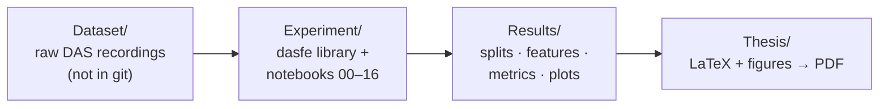

# Event Classification in Distributed Acoustic Sensing: A Multi-Domain Feature Engineering Approach

Master of Science in Information Technology thesis, Universiti Teknologi PETRONAS.
**Reeyan Afzal Khan**, supervised by Dr Shuhaida Bt M Shuhidan and
Assoc. Prof. Ts Dr Izzatdin B A Aziz.

1,002 handcrafted features across four signal-processing domains, ensemble feature
selection, class balancing and a benchmark of seven lightweight classifiers, evaluated
on two independent DAS datasets under group-aware splits that make data leakage
structurally impossible. This repository holds the experiment code, the frozen splits
and result tables, the figures, and the LaTeX source of the thesis.

The code accompanying the journal article is also published as
[IJIES-JOURNAL-FEFS-DAS](https://github.com/reeyan-afzal-khan/IJIES-JOURNAL-FEFS-DAS).

---

## How the repository fits together



1. **`Dataset/`** holds the two public datasets exactly as downloaded.
2. **`Experiment/`** runs notebooks 00–16 in order. Each stage reads its inputs from
   `Results/` and writes its outputs back, so any stage can be re-run on its own.
3. **`Results/`** collects everything the notebooks produce: per dataset (`cao/`,
   `tomasov/`) and cross-dataset (`shared/`).
4. **`Thesis/`** is the LaTeX source. `Thesis/Figures/` is the single home of the figures
   it includes, with their draw.io sources in `Thesis/Figures/drawio/`.

| Folder | Contents | In git |
|---|---|---|
| `Dataset/` | Cao 2023 and Tomasov 2024 raw data | no, ~47 GB ([how to obtain it](Dataset/README.md)) |
| `Experiment/` | `dasfe/` library, notebook series, `notebook_specs/`, helper scripts | yes |
| `Results/` | outputs of every notebook | tables, manifests, plots and selection masks yes; large `.npy` arrays no (~53 GB) |
| `Rerun/` | outputs of full re-runs with `_run_all.py`, kept apart from `Results/` | tables and notebooks yes; logs and large arrays no |
| `Thesis/` | LaTeX source, figures and their draw.io sources | yes, except build artefacts |
| `scripts/` | environment setup, health check, thesis build | yes |
| `archive/` | superseded material kept locally for reference | no |

`Dataset/`, `Experiment/` and `Results/` keep the names and layout of `Paper_Reeyan/` on
the Jetson Orin, and every path is resolved relative to the checkout, so the same tree
runs on both machines without edits.

---

## Setup: Windows workstation (NVIDIA GPU)

```powershell
.\scripts\setup_env.ps1
```

This builds `.venv` with:

- **Python 3.13.9**, the Jetson's interpreter, installed by [uv](https://docs.astral.sh/uv/)
  as a standalone build (independent of Anaconda);
- **PyTorch 2.14.1 for CUDA 12.6**, the CUDA version of the Jetson's JetPack 6;
- the pinned packages in [requirements.txt](requirements.txt). The core scientific stack
  carries the exact versions recorded on the Jetson by notebook 00.

It then runs the health check. Re-running it only adds what is missing;
`-Recreate` rebuilds from scratch, and `-Recreate -Cuda cu130` rebuilds with another
CUDA build of PyTorch.

Check the environment at any time:

```powershell
.venv\Scripts\python scripts\check_env.py
```

The check reports package versions, runs a matrix multiply on the GPU, imports `dasfe`
(which asserts the 1,002-feature total), and confirms that every raw file named in the
frozen manifests resolves on this machine.

Run the notebooks in VS Code with the `.venv` interpreter, or start JupyterLab from the
repository root (kernels start in the notebook's own folder, `Experiment/`):

```powershell
.venv\Scripts\jupyter lab
```

## Setup: Jetson Orin, or any Linux machine

```bash
bash scripts/setup_env.sh
```

NVIDIA publishes JetPack 6 PyTorch wheels for Python 3.10 only, so on the Jetson the
script builds the same two environments the original run used:

| Environment | Python | Used for |
|---|---|---|
| `.venv` | 3.13.9 | notebooks 00–09, 12, 14, 15 |
| `.venv-torch` | 3.10, NVIDIA's JetPack PyTorch | the CNN notebooks 10, 11, 13, 16 |

`requirements.txt` carries the Python 3.10 pins as environment markers, so one file
serves every environment. On x86-64 Linux the script builds a single `.venv` with CUDA
PyTorch, as on Windows.

If the data stays on the Jetson's existing mount, point the code at it instead of
copying it:

```bash
export DAS_DATASET_DIR=/mnt/<disk>/Paper_Reeyan/Dataset
export DAS_RESULTS_DIR=/mnt/<disk>/Paper_Reeyan/Results
```

The frozen manifests in `Results/` store the Jetson's absolute paths. `dasfe` re-roots
them onto the current `Dataset/` at load time (`config.data_path`), so they work
unchanged on either machine.

---

## Editing the thesis

`Thesis/` is the LaTeX project. It started from `Reeyan-Thesis.zip`, the original Overleaf
export, which stays in the working folder and is not committed. The thesis builds with
pdfLaTeX and biblatex, using bibtex8 as the bibliography backend: Windows Smart App
Control blocks MiKTeX's unsigned `biber.exe`. The typeset references are identical. Keep
`ref.bib` ASCII, writing accents as LaTeX escapes (`{\"u}`), as bibtex8 is not Unicode-aware.

Every figure the thesis includes sits in `Thesis/Figures/`, with the draw.io sources in
`Thesis/Figures/drawio/`. Figure 3.2 (`fig03_EC_pineline.png`) is exported from
`drawio/fig3-pipeline.drawio`; `fig03_EC_pineline_sept.drawio` is its September 2026 version.

Toolchain on the workstation:

- **[MiKTeX](https://miktex.org/)**, a TeX distribution that installs missing LaTeX
  packages automatically the first time a document needs them.
- **VS Code with [LaTeX Workshop](https://marketplace.visualstudio.com/items?itemName=James-Yu.latex-workshop)**,
  the editor: live PDF preview, SyncTeX (Ctrl+click jumps between source and PDF), and
  `\ref`/`\cite` completion. The build recipe is preconfigured in
  [.vscode/settings.json](.vscode/settings.json).

Open `Thesis/main.tex` in VS Code and save to build it, or build from a terminal:

```powershell
.\scripts\build_thesis.ps1        # -> Thesis\main.pdf
```

The build runs inside `Thesis/` on purpose. biblatex always reads the `main.bbl` that
sits next to `main.tex`, so building into a separate folder would silently ignore edits
to `ref.bib`. All build artefacts, `main.bbl` and `main.pdf` included, are git-ignored, so a
build leaves the tracked sources untouched.

To set up the same toolchain on another Windows machine:

```powershell
winget install MiKTeX.MiKTeX --scope user
initexmf --set-config-value=[MPM]AutoInstall=1      # install missing packages without asking
code --install-extension James-Yu.latex-workshop
```

---

## Why the original protocol leaked

### Tomasov et al. 2025

Windows are 8,192 samples with a 2,048-sample hop — **75% overlap**. The submitted
version used a random stratified 80/10/10 split, so a test window could share 6,144 of
its 8,192 raw samples with a training window. Notebook 02 measures it:

| protocol | test windows | sharing raw samples with train |
|---|---|---|
| random stratified 80/10/10 (submitted) | 43,976 | **43,976 (100.0%)** |
| blocked segment + guard band (revised) | 31,028 | **0 (0.0%)** |

Compounding factors: adjacent fibre channels are 1.02 m apart and see the same event, and
there are only **16 HDF5 recordings** for 9 classes — five classes come from a single
recording, so leave-one-recording-out is impossible for the full taxonomy.

### Cao et al. 2023

Filenames encode `<date>_<operator>_<event>_<session>_data_<n>.mat`. Parsing all 15,419
records gives 441 recording sessions — and **423 of them (95.9%) contribute samples to
both the released `Training/` and `Test/` folders**. The published 8:2 split leaks at the
session level, so the SVM and CNN baselines shipped with the dataset measure
within-recording memorisation as much as event recognition.

---

## Revised split protocol

| | Cao 2023 | Tomasov 2025 |
|---|---|---|
| Split group | recording session (441) | contiguous recording segment (154) |
| Mechanism | `StratifiedGroupKFold`, 10 folds merged 8/1/1 | 10 contiguous equal-**mass** segments per recording, rotated assignment |
| Guard band | not needed (samples are pre-segmented, no overlap) | 4 blocks = one full window at every split boundary |
| Robustness split | leave-one-date-out (notebook 08) | leave-one-recording-out, 4 classes with ≥2 recordings (notebook 08) |

Segments are cut by **window mass**, not duration. A first attempt using
`StratifiedGroupKFold` over fixed-duration zones balanced *group counts*, but a zone
holds anywhere from ~30 to ~8,000 windows — producing a 92/5/2 split in which the
`openclose` class received **no test samples at all**.

Guard-band removal costs 8.9% of the annotated windows and moves the realised split to
84.6 / 7.6 / 7.8. That is the price of the guarantee, and it is stated rather than hidden.

### Every leakage channel and its control

| Leak | Source | Control | Enforced in |
|---|---|---|---|
| Sample-level | 75% window overlap | guard bands + `assert_no_sample_overlap` | `splits.py`, nb 02 |
| Recording-level | many windows per recording | whole-group splitting | `splits.py`, nb 02 |
| Selection-level | selectors fitted on all data | training folds only; re-fitted per CV fold | `selection.py`, nb 05 |
| Resampling-level | SMOTE fitted before splitting | sampler inside `imblearn.Pipeline` | `balancing.py`, nb 06 |
| Scaling-level | scaler fitted on train+test | `StandardScaler` in the same pipeline | `balancing.py`, nb 06 |

---

## Notebook series

Run in order. Several notebooks are parameterised by constants in their configuration
cell, and each executed copy is saved with a suffix naming its configuration, e.g.
`06_balancing_and_model_benchmark (tomasov_full_1002).ipynb`:

- `DATASET = "cao"` or `"tomasov"` — notebooks 03–07, run once per dataset;
- `USE_SELECTED` — notebooks 06–07: `False` = all 1,002 features, `True` = the 8/8
  consensus subset;
- `VARIANT = "full_1002"` or `"8_consensus"` — notebook 09.

| # | Notebook | Produces |
|---|---|---|
| 00 | `00_setup_and_environment` | dependency check, `Results/` tree, environment record |
| 01 | `01_dataset_inventory_and_leakage_audit` | manifests, the Cao official-split leakage audit, dataset comparison table |
| 02 | `02_leakage_safe_splits` | frozen split manifests + leakage scorecards (**these assert**) |
| 03 | `03_feature_extraction` | 1,002 features/window, chunked and resumable |
| 04 | `04_multidomain_fusion` | `X_multi.npy` (1,002 cols) + alignment checks |
| 05 | `05_feature_selection` | 8-method ensemble, consensus subset, Jaccard, selection-bias analysis |
| 06 | `06_balancing_and_model_benchmark` | 7 models × 6 strategies, domain comparison, grouped CV |
| 07 | `07_final_model_and_ablation` | per-class report, confusion matrices, class-removal ablation |
| 08 | `08_cross_dataset_generalisation` | parallel benchmark, cross-system transfer, LODO/LORO |
| 09 | `09_statistics_efficiency_and_report` | Friedman/Nemenyi, efficiency, all export tables |
| 10 | `10_cao_cnn_baseline` | Cao's own 2D CNN (7,421 params) on their split **and** ours |
| 11 | `11_tomasov_cnn_baseline` | Tomasov's CNN from IEEE Access §III-E, with the RDFT front end |
| 12 | `12_spatial_confound_ablation` | leave-one-domain-out + recording-identity probe — **decides the headline claim** |
| 13 | `13_cnn_protocol_attribution` | Tomasov CNN gap split into protocol vs. reconstruction: same model, blocked vs. random split vs. stride 256 |
| 14 | `14_repeated_splits_and_bootstrap` | repeated group-aware splits (5 seeds), group-level bootstrap CIs, paired Wilcoxon over held-out acquisitions |
| 15 | `15_pipeline_protocol_attribution` | the same protocol attribution for every feature-pipeline configuration (full, consensus, each selector, PCA, LDA) |
| 16 | `16_sota_head_to_head` | S2-DyGNN, DASViT1D, DAStatFormer, CNN-LSTM, GCN and GAT re-run under the leakage-safe protocol |

### Notebooks 10–12: published baselines and the confound check

`dasfe/baselines.py` reproduces each dataset's own CNN rather than a generic one:

- **Cao et al. 2023** — their released `models.py` verbatim: a *2D* CNN over the whole
  10000×12 record, **7,421 parameters**, per-sample min-max scaling to 0–255. Verified to
  reproduce their documented tensor shapes `(5,99,7)` then `(10,10,4)`.
- **Tomasov et al. 2025** — transcribed from IEEE Access §III-E (64/256 Conv1D filters,
  LeakyReLU, pool 4, `Dense(256)` sigmoid, softmax) with the **RDFT front end of §III-C**,
  because that paper explicitly rejects raw time-domain input. `dense_units=1024`
  reproduces Table 21 of the manuscript (33,155,849 params) for traceability.
- RDFT redundancy factor **6** is *inferred* from their two stated facts (2048 bins ↔
  0–833 Hz at 20 kHz); recorded in `tomasov_cnn_assumptions.json`.

Notebook 12's recording-identity probe holds the event class fixed and asks each domain to
predict *which recording* a window came from. It was validated on synthetic data with a
planted fingerprint: it flagged the planted domain at +39 to +45 pp above chance and left
the others at or below chance.

Set `SMOKE_TEST = True` for a fast end-to-end validation of the whole chain (~60 windows
per class), then `SMOKE_TEST = False` for the real run.

### Notebooks 13–16: reviewer responses

- **13** keeps one architecture, front end and training recipe, and changes only the
  partition, to show whether the gap to Tomasov's published CNN accuracy comes from the
  evaluation protocol or from the reconstruction (R2C3).
- **14** replaces the Friedman test over non-independent balancing strategies with
  repeated splits, a group-level bootstrap and paired tests over held-out acquisitions
  (R2C5). The machinery lives in `dasfe/robust.py`.
- **15** applies the one-population, two-partition attribution to every configuration
  the paper reports, refitting selection and dimensionality reduction inside each arm.
- **16** reimplements recent DAS classifiers (`dasfe/sota.py`) and runs them on the same
  partitions, preprocessing and metrics as the feature pipeline (R1C4, R2C1, R2C2).

---

## The two-dataset argument

The submitted paper argued Cao was unusable for validation: different sensing principle,
one overlapping class, only 12 spatial channels. All three are true, and all three only
rule out *transferring a fitted model*. They do not rule out **re-running the
methodology** — which is the claim the paper actually needs.

Notebook 08 runs four experiments:

1. **Parallel benchmark** — identical pipeline on both datasets. If the domain ranking
   and classifier ranking agree across two interrogators, the conclusion is about the
   method, not the fibre. Reported as Spearman ρ.
2. **Cross-system transfer** on a harmonised 4-class taxonomy:

   | harmonised | Cao | Tomasov |
   |---|---|---|
   | `background` | background | regular |
   | `walk` | walk | walk |
   | `impact` | knock | fence (knocking) |
   | `excavation` | dig | construction |

   Spatial features are excluded — they depend on channel spacing (10 m vs 1.02 m) and
   count (12 vs 32), so transferring them would be meaningless rather than merely hard.
3. **Leave-one-date-out** (Cao) — robustness to day-to-day soil/temperature/operator drift.
4. **Leave-one-recording-out** (Tomasov) — the strictest test the data supports.

---

## Feature space (unchanged from the submission)

| Domain | Count | Prefix | Notes |
|---|---|---|---|
| Time | 112 | `TIME:` | statistics, energy, temporal, slope, nonlinear, envelope, burst, histogram |
| Frequency | 90 | `FREQ:` | spectral stats/shape, peaks, 7 band powers, entropy, PSD, histogram, cepstrum |
| Time-frequency | 739 | `TF:` | STFT, DWT (7 levels), WPT (16 sub-bands), GLCM, LBP, HOG, geometry, DAS metrics |
| Spatial / spatio-temporal | 61 | `SPAT:` | localisation, distribution, gradient, clustering, motion, texture |
| **Multi-domain** | **1,002** | | |

Dimensionality is asserted at import time — `import dasfe` fails if any extractor drifts.

Two deliberate deviations, both documented in code:

- **STFT resolution.** The original used `nfft=4096, hop=2048`, giving ~5 frames per
  window — too thin for GLCM/LBP/HOG texture descriptors. Default is now `512/128`
  (257 × 61 image); the original values are kept in `config.PAPER_NFFT_STFT` for ablation.
- **Coefficient of variation.** Per-window z-scoring forces `mean = 0`, so `std/|mean|`
  diverged to ~1e12. That slot now holds the scale-invariant `rms/MAD`.
- **Constant by construction.** 41 features are constants once every channel is z-scored:
  nine time-domain amplitude descriptors (mean, std, variance, SEM, RMS, energy, log
  energy, mean power, Hjorth activity), the 29 channel-energy-profile descriptors (each
  channel's energy is fixed at `T`, so the profile is flat) and the patch's mean, standard
  deviation and energy. They keep their columns, so the published 1,002-dimensional
  layout is unchanged, and the variance selector removes them — reported, not hidden.

### Reproducible feature selection

The consensus subsets must not depend on the machine they are computed on. Three rules
enforce that:

- **Fixed row order.** Fusion orders rows as the frozen split manifest does, not in
  extraction order. Extraction order depends on how the platform's sort breaks ties
  between Tomasov windows that share a start time, and every subsample, bootstrap and CV
  fold downstream depends on row order.
- **No arbitrary ties at the 50% cut.** Each method keeps the top half of the eligible
  features. mRMR ranks every feature instead of leaving a tail tied at zero. Boruta
  orders the features it confirms (all tied at rank 1) by their median importance across
  its iterations. RFE orders each eliminated block by the coefficient importance it was
  eliminated on, from a logistic regression solved to `tol=1e-8`, so that the elimination
  order reflects the data rather than where the solver stopped. Any exact tie that
  remains goes to the feature the other methods rank higher, then to the lower column
  index.
- **No feature is decided by rounding, and none sees amplitude.** The z-score divides by
  the standard deviation exactly. The earlier `(x − mean)/(sd + 1e-12)` left every
  channel with energy `T·(1 − 2e-12/sd)`, a ~1e-14 imprint of its raw amplitude that
  LightGBM split on: on Tomasov, 13 channel-energy-profile descriptors carried about 7
  accuracy points of the headline model through it, the recording fingerprint the
  normalisation exists to remove. Quantities that are constant by construction (the means
  of z-scored data and the flat channel-energy profile) are written as their exact values,
  and the magnitude spectrum is floored 120 dB below its peak, so the ~1e-13 DC bin of a
  de-meaned window no longer sets the spectral minimum, the histogram range or the
  cepstrum. `Experiment/_amplitude_audit.py` checks both properties - no feature moves
  under a per-channel gain (×0.25–4) or a `1 + 1e-12·noise` perturbation - so
  `config.UNSTABLE_FEATURES`, the 36 features once held out of selection, is empty.

---

## Efficiency

Extraction is **one pass over the raw data for all four domains**. The original ran four
separate passes, reading and preprocessing every window four times (~23 h total).
Measured on the original workstation (22 workers):

| dataset | ms/window (1 core) | throughput | est. full run |
|---|---|---|---|
| Cao (15.4k windows) | 36.8 | ~10 win/s | ~25 min |
| Tomasov (172k windows) | 66.1 | ~18 win/s | ~2.7 h |

Tomasov throughput is HDF5-read-bound, not CPU-bound. Chunks are one recording each, so
the file is opened once per chunk rather than once per window.

**Real-time framing.** A new window arrives every `2048 / 20000 = 102.4 ms`. Inference is
sub-millisecond, but *feature extraction* is the binding constraint — notebook 09
computes how many cores meet the budget. The honest claim is that the **classifier** is
lightweight, not the whole pipeline.

---

## `Experiment/` in detail

```text
Experiment/
├── dasfe/                 shared library (below)
├── notebook_specs/        notebook sources as reviewable .py
├── NN_*.ipynb             the notebook series, executed, with outputs
├── _make_notebooks.py     regenerate .ipynb from the specs
├── _run_notebook.py       execute a notebook in-process (validation)
├── _run_all.py            re-run the whole executed series: resumable, streams a live log
├── _compare_results.py    compare two Results trees file by file (e.g. Jetson vs re-run)
├── _feature_stability.py  find the features whose values are decided by rounding
├── _amplitude_audit.py    check that no feature responds to a per-channel gain or to rounding
├── _corrected_spatial_verdict.py  notebook 12's corrected confound verdict (verdict_corrected.json)
├── _refresh_head_to_head.py  notebooks 10-11's head-to-head tables from the saved CNN results (no retraining)
├── _seed_variance.py      retrain notebook 16's S2-DyGNN and DAStatFormer under further seeds (run-to-run spread)
├── _reconcile_R1C9.py     reconcile the two Tomasov test-window counts from stored artefacts
└── _verify_transfer.py    confirm a copied checkout runs the fixed code (stale bytecode check)
```

| Module | Responsibility |
|---|---|
| `config.py` | paths, seeds, window geometry, dataset specs, split policy, hyper-parameters |
| `manifests.py` | sample-level manifests + the Cao official-split audit |
| `splits.py` | grouped splitters, guard bands, and the **audits that raise** |
| `preprocess.py` | demean → band-pass → z-score; Cao `.mat` and Tomasov HDF5 loaders |
| `features_{time,freq,tf,spatial}.py` | the four extractors (112 / 90 / 739 / 61) |
| `extract.py` | chunked resumable parallel extraction + shard assembly |
| `fusion.py` | domain concatenation with prefixed names + alignment checks |
| `selection.py` | the 8 selectors, consensus voting, Jaccard |
| `balancing.py` | leak-safe resampling pipelines |
| `models.py` | the 7 classifiers + the DAS_CNN baseline |
| `evaluate.py` | metrics, benchmark loop, grouped CV, Friedman/Nemenyi |
| `baselines.py` | the published Cao and Tomasov CNN baselines (notebooks 10, 11, 13) |
| `robust.py` | repeated group-aware splits, group bootstrap, paired tests (notebook 14) |
| `sota.py` | reimplementations of recent DAS classifiers (notebook 16) |

Editing a notebook: change `notebook_specs/nb_*.py`, then run `_make_notebooks.py`.
Editing the `.ipynb` directly works too, but the change is lost on the next regeneration.
Regeneration also **overwrites the executed notebooks that share a template's name**
(00–02, 08, 10–16) and their saved outputs — commit first so they can be restored.

---

## Reproducing

From `Experiment/`, with the environment's interpreter:

```powershell
..\.venv\Scripts\python _make_notebooks.py                      # regenerate all .ipynb from specs
..\.venv\Scripts\python _run_notebook.py 02_                    # validate one notebook headlessly
..\.venv\Scripts\python _run_notebook.py 05_ DATASET='"tomasov"'  # override a config constant
```

On Linux and the Jetson, use `../.venv/bin/python` instead. `_run_notebook.py` executes
the code cells in-process and does not write outputs back into the notebook.

### Full re-run

`_run_all.py` re-executes every saved notebook, in order and with its recorded
configuration, each in a fresh kernel. It writes the executed copies to a separate folder
and, with `DAS_RESULTS_DIR` set, all stage outputs to a separate results tree, so
`Results/` stays untouched. It is resumable and stops at the first failing notebook.

```powershell
$env:DAS_RESULTS_DIR = "..\Rerun\Results"
..\.venv\Scripts\python _run_all.py ..\Rerun\notebooks
```

Every line the notebooks print streams to `Rerun\notebooks\live.log` as it happens, and
each executed copy is saved after every cell. Watch the run from a second terminal:

```powershell
Get-Content ..\Rerun\notebooks\live.log -Wait -Tail 40 -Encoding UTF8
```

Then compare the re-run with the reference results, file by file:

```powershell
..\.venv\Scripts\python _compare_results.py ..\Results ..\Rerun\Results --md ..\Rerun\COMPARISON.md
```

Seed is `42` throughout (`config.SEED`); splits are frozen to disk in notebook 02 and
never re-derived downstream.
